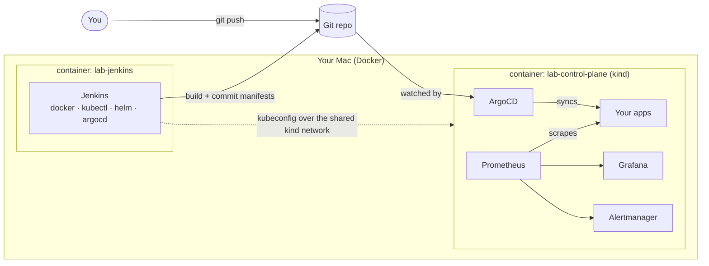

<div align="center">


### A complete local DevOps playground. One command up, one command down.


[Portfolio page](docs/index.html) · [Architecture](docs/ARCHITECTURE.md) · [Troubleshooting](docs/TROUBLESHOOTING.md) · [Changelog](CHANGELOG.md)

</div>

---

## ✨ What is this?

DevOps Lab sets up a full CI/CD and GitOps environment on your laptop, for learning and experiments, with no cloud account needed.

| Tool | URL | Login | Runs in |
|------|-----|-------|---------|
| 🏗️ **Jenkins** | http://localhost:8080 | `admin` / `admin123` | its own Docker container |
| 🐙 **ArgoCD** | http://localhost:8081 | `admin` / run `lab creds` | kind cluster |
| 📈 **Grafana** | http://localhost:8082 | `admin` / `admin123` | kind cluster |
| 🔥 **Prometheus** | http://localhost:8083 | none | kind cluster |
| 🚨 **Alertmanager** | http://localhost:8084 | none | kind cluster |
| 🧪 **Podinfo demo** | http://localhost:9090 | none | kind cluster, deployed by ArgoCD from your local `gitops/` folder |

> The logins above are for a localhost-only lab. Everything binds to `127.0.0.1`. Never reuse these passwords elsewhere.

## 📂 GitOps from a local folder (no GitHub needed)

**One folder per application.** Everything an app needs lives in its own folder under `gitops/apps/`:

```
gitops/apps/
├── podinfo/            Helm app:   Chart.yaml + values.yaml
│   ├── Chart.yaml
│   └── values.yaml
└── hello-web/          plain YAML app
    └── hello-web.yaml
```

The folder name is the ArgoCD app name **and** the Kubernetes namespace. No separate Application file is needed: an ArgoCD ApplicationSet (`lab-apps`) turns every folder into an app.

```bash
nano gitops/apps/podinfo/values.yaml   # e.g. change ui.message
lab sync                               # ArgoCD rolls the change out
```

| I want to... | Do this, then `lab sync` |
|---|---|
| Add a plain-YAML app | create `gitops/apps/<name>/` and put your `*.yaml` files in it |
| Add a Helm app | create `gitops/apps/<name>/` with a `Chart.yaml` (copy podinfo's) and a `values.yaml` |
| Change a setting | edit the app's `values.yaml` or YAML |
| Remove an app | delete its folder |

Your files are never overwritten by the lab. ArgoCD can only read git repos, so the lab copies the folder into a small git snapshot and serves it from a tiny in-cluster git server (`lab-git`). You never run git yourself. Details are in [docs/ARCHITECTURE.md](docs/ARCHITECTURE.md).

## 🧭 Architecture



Jenkins runs **outside** the cluster on the same Docker network, so pipelines can call `kubectl`, `helm`, `docker` and `argocd` directly. Details are in [docs/ARCHITECTURE.md](docs/ARCHITECTURE.md).

## 🚀 Quick start

**Requirements:** a Mac, Docker Desktop or OrbStack (give it about 8 GB RAM), and [Homebrew](https://brew.sh). The script installs `kind`, `kubectl`, `helm`, `k9s` and `argocd` for you.

```bash
git clone <your-repo-url> devops-lab && cd devops-lab
./lab.sh up          # first run takes roughly 15-20 minutes
source ~/.zshrc      # enables the short alias: lab
```

### Daily routine

```bash
lab start     # morning: cluster first, then Jenkins
k9s           # explore the cluster
lab stop      # evening: Jenkins first, then the cluster. Data is kept
```

### All commands

| Command | What it does |
|---------|--------------|
| `lab up` | First-time setup. Safe to re-run |
| `lab start` | Start everything and re-connect ArgoCD |
| `lab stop` | Stop everything, keep all data |
| `lab status` | Containers, pods, services, URLs and logins |
| `lab creds` | Just the URL and login table |
| `lab verify` | Prove where each tool runs |
| `lab sync` | Push edits from `gitops/` to ArgoCD |
| `lab init` | Create your `lab.env` settings file |
| `lab configs` | Regenerate config files only |
| `lab destroy` | Delete the cluster and Jenkins container, keep `jenkins_wp/` |
| `lab destroy --purge` | Same, and wipe `jenkins_wp/` too |

Every command finishes with the same summary: containers, nodes, pods, NodePort services and the URL/login table with live UP/DOWN status.

## 🔌 How the pieces are connected

- **Jenkins ⇄ your disk.** The local folder `jenkins_wp/` is used by Jenkins only. It is the container's `/var/jenkins_home`, so you can browse its files from your Mac without logging into the container (jobs, plugins and settings also survive rebuilds).
- **Jenkins ⇄ cluster.** The Jenkins container joins the `kind` Docker network and gets a kubeconfig pointing at `lab-control-plane:6443`.
- **ArgoCD ⇄ cluster.** ArgoCD manages the cluster it runs in (`in-cluster`). Two demo apps (`podinfo`, `hello-web`) are deployed automatically and show up in the ArgoCD UI.
- **ArgoCD ⇄ CLI.** `lab up` and `lab start` log the `argocd` CLI in, both on your Mac and inside Jenkins.
- **Prometheus ⇄ ArgoCD.** ArgoCD metrics are exposed through ServiceMonitors, which Prometheus picks up.

## 🧪 Try it

```bash
argocd app list                     # lab-apps, podinfo, hello-web
kubectl get pods -n podinfo         # what ArgoCD deployed
open http://localhost:9090          # the podinfo demo app
```

A starter pipeline is in [examples/Jenkinsfile](examples/Jenkinsfile). Create a Pipeline job in Jenkins and paste it in.

## 📁 Project layout

```
.
├── lab.env.example         # all settings (copy to lab.env)
├── lab.sh                  # the one script (heavily commented)
├── kind-config.yaml        # cluster + port mappings (generated)
├── argocd-values.yaml      # ArgoCD Helm values (generated)
├── monitoring-values.yaml  # Prometheus/Grafana Helm values (generated)
├── gitops/                 # YOUR apps + Helm values files (edit these)
├── jenkins/                # Jenkins image: Dockerfile, plugins, JCasC (generated)
├── jenkins_wp/             # Jenkins home on your Mac (git-ignored)
├── examples/Jenkinsfile    # sample CI → ArgoCD pipeline
├── docs/                   # portfolio page, architecture, troubleshooting
└── Makefile                # make up / start / stop ...
```

Config files are regenerated from `lab.sh` (see the settings block at the top), so change ports or passwords there and run `lab configs`.

## 🛠️ Customise

Your settings live in a plain `lab.env` file, so you never edit `lab.sh`:

```bash
lab init            # creates lab.env from lab.env.example
nano lab.env        # e.g. CLUSTER=demo, JENKINS_PORT=9000, ARGOCD_PORT=9001
lab destroy && lab up   # needed after changing ports or the cluster name
```

You can set the cluster name, every port, logins, Jenkins heap size and whether the sample app is deployed. See [lab.env.example](lab.env.example) for the full list.

Files are read in this order, and later ones win: built-in defaults, then `~/.config/devops-lab/lab.env` (global, shared by every copy of the lab), then `./lab.env`, then the file named in `LAB_ENV_FILE`. Port numbers and the cluster name are validated before anything runs.

> kind cannot change port mappings on a live cluster, so port or name changes need `lab destroy` first. Password or heap changes only need `lab configs && lab start`.

## 🩺 Troubleshooting

See [docs/TROUBLESHOOTING.md](docs/TROUBLESHOOTING.md). The most common causes are a port already in use, or too little Docker memory.

## 🤝 Contributing

Ideas and fixes are welcome. Read [CONTRIBUTING.md](CONTRIBUTING.md) first, and report security issues as described in [SECURITY.md](SECURITY.md).

## 📜 License

MIT, see [LICENSE](LICENSE).
