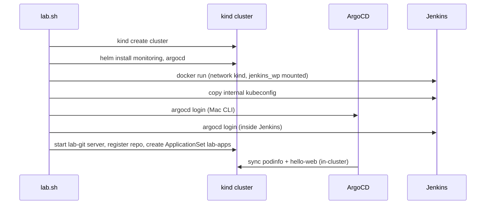

# Architecture

## Containers

| Container | Image | Purpose |
|-----------|-------|---------|
| `lab-jenkins` | `lab-jenkins:latest` (built from `jenkins/Dockerfile`) | Jenkins plus docker, kubectl, helm and argocd CLIs |
| `lab-control-plane` | kind node image | The whole Kubernetes cluster (single node) |

Both attach to the Docker network `kind`, so they resolve each other by name.

## Why Jenkins is outside the cluster
- It restarts and upgrades independently of the cluster.
- Rebuilding the cluster never touches Jenkins data.
- Pipelines can use the Mac's Docker daemon directly (via the mounted socket) to build images.

## Data and persistence

| Data | Where |
|------|-------|
| Jenkins home (jobs, plugins, credentials) | `./jenkins_wp` on your Mac, bind-mounted at `/var/jenkins_home`. Used by Jenkins only, so its files are visible locally without logging into the container |
| Prometheus data (5 Gi PVC, 3 day retention) | Inside the kind node |
| Grafana data (2 Gi PVC) | Inside the kind node |

`lab stop` keeps all of it. `lab destroy` deletes the cluster data but keeps `jenkins_wp`. Use `--purge` to remove that as well.

## Ports

| Mac port | Target | Notes |
|----------|--------|-------|
| 8080 | Jenkins container port 8080 | Docker `-p` mapping |
| 8081 | kind node 30080 → ArgoCD | kind `extraPortMappings` |
| 8082 | kind node 30082 → Grafana | |
| 8083 | kind node 30083 → Prometheus | |
| 8084 | kind node 30084 → Alertmanager | |
| 9090 | kind node 30090 | Free for your own apps |
| 6443 | Kubernetes API | Pinned so the kubeconfig survives restarts |

Port mappings are fixed when the cluster is created. To change one, edit `lab.sh`, then `lab destroy` and `lab up`.

## Connections

## GitOps from a local folder

ArgoCD cannot read a plain folder, only a git repository, so the lab bridges the gap:

1. You edit `./gitops` (apps, Helm values files, manifests).
2. `lab sync` copies it into a git snapshot at `./.lab-git/gitops` and commits when something changed.
3. That snapshot is mounted into the kind node at `/lab/git` (a kind `extraMounts` entry, set when the cluster is created).
4. The `lab-git` Deployment (alpine/git, `git daemon`) serves it as `git://lab-git.lab-git.svc.cluster.local/gitops`.
5. ArgoCD has that URL registered as a repository. An ApplicationSet named `lab-apps` (git directory generator on `apps/*`) creates one ArgoCD Application per folder. The folder name is the app name and the namespace, so adding, renaming or deleting a folder adds, renames or removes the app.

Inside an app folder ArgoCD detects the type automatically: `Chart.yaml` means a Helm chart, plain `*.yaml` files mean raw manifests. `podinfo` is a small wrapper chart whose only job is to depend on the public podinfo chart, so its `values.yaml` sits in the same folder (settings go under the `podinfo:` key). `hello-web` is plain manifests.

`lab sync` also triggers a hard refresh, otherwise ArgoCD would notice changes within its 3 minute poll. The `git://` transport is unauthenticated, which is fine because it is reachable only inside the cluster.

## Startup order
`lab start` brings up the cluster first (Jenkins needs its network and API), then Jenkins. `lab stop` does the reverse.
